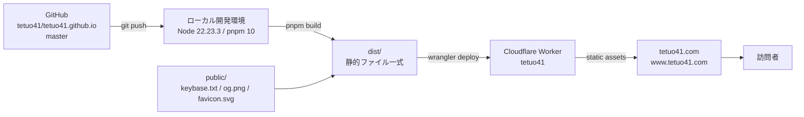

# Infrastructure — tetuo41.com

最終検証: 2026-10-22(本番デプロイ実測に基づく。推測値は含めない)

## 全体構成



サーバーサイド処理なし。Worker は `dist/` をそのまま配信する静的アセットホストとしてのみ機能する(Cloudflare Pages ではない)。

## 構成コンポーネント

| 項目 | 実測値 |
|---|---|
| ホスティング | Cloudflare Workers(Static Assets モード) |
| Worker 名 | `tetuo41`(`wrangler.jsonc` の `name`) |
| Cloudflare アカウント | `Tetuo41@gmail.com's Account` / `7ca7b19be5c1b13083164788640e5d0d` |
| カスタムドメイン | `tetuo41.com`, `www.tetuo41.com`(`routes` で `custom_domain: true`) |
| TLS | Cloudflare 管理(証明書の手動更新なし) |
| オリジン | なし(静的アセットのみ) |
| ビルド | Astro 7 静的出力 → `dist/`(`output: "static"`) |
| Node | `>=22.22.0`(engines)。Astro 7 は 22.16 で起動拒否する。動作確認済みは v22.23.3 |
| パッケージマネージャ | pnpm 10 |
| CI/CD | **なし**。`.github/` 未設定。デプロイはローカルからの手動実行のみ |
| 実行時シークレット | なし(環境変数・bindings・D1/KV/R2 いずれも未使用) |
| compatibility_date | `2026-10-19` |

## リポジトリ内のインフラ関連ファイル

| パス | 役割 |
|---|---|
| `wrangler.jsonc` | Worker 名・アセットディレクトリ・カスタムドメイン定義 |
| `astro.config.mjs` | Astro 設定(現状デフォルト) |
| `public/` | ビルド時に `dist/` 直下へコピーされる静的ファイル |
| `public/keybase.txt` | **恒常要件**(下記)。改変・削除禁止 |
| `public/.assetsignore` | Worker アセットから除外するファイル(`_worker.js`, `_routes.json`)。`keybase.txt` は除外しない |
| `scripts/quality-gate.sh` | デプロイ前ゲート(typecheck + build + audit) |
| `dist/`, `.astro/`, `.wrangler/`, `.impeccable/review/` | 生成物・ローカル状態。gitignore 済み |
| `CNAME`(リポジトリ直下) | GitHub Pages 時代の遺産。`public/` 外のため配信されない。未使用 |
| `public/.nojekyll` | 同上(Pages 遺産)。無害 |

## 恒常要件: `/keybase.txt`

- Keybase の Web 証明が `https://tetuo41.com/keybase.txt` で検証可能であることが本サイトの根幹(PRODUCT.md)
- `public/keybase.txt` をそのまま配信する。**内容の改変・削除・リネーム禁止**
- ビルド後の確認: `ls dist/keybase.txt`、デプロイ後の確認: `curl -s -o /dev/null -w "%{http_code}" https://tetuo41.com/keybase.txt` が `200`

## デプロイ手順(標準フロー)

```sh
pnpm install
bash scripts/quality-gate.sh     # typecheck + build + audit が PASS すること
pnpm build                       # dist/ を再生成
pnpm run deploy                  # = wrangler deploy
```

> **注意**: pnpm 10 では `pnpm deploy` は pnpm 組み込みのワークスペース機能として解釈され `ERR_PNPM_CANNOT_DEPLOY` で失敗する。必ず `pnpm run deploy`(または `pnpm exec wrangler deploy`)を使う。

### デプロイ後の検証

```sh
# 新デザインのマーカー(TETUO41 / SIGNATURE VERIFIED / #050505)
curl -s https://tetuo41.com/ | grep -o 'TETUO41\|SIGNATURE VERIFIED' | sort | uniq -c

# 恒常要件
curl -s -o /dev/null -w "keybase.txt:%{http_code}\n" https://tetuo41.com/keybase.txt

# www 側
curl -s -o /dev/null -w "www:%{http_code}\n" https://www.tetuo41.com/
```

ブラウザでの確認項目: 背景 `rgb(5,5,5)` / 本文 `rgb(250,250,250)` / `Archivo Black` ロード / 横スクロールなし / リンク 9 件。

## 認証

### 対話環境(OAuth)

```sh
pnpm exec wrangler login      # ブラウザで承認
pnpm exec wrangler whoami     # アカウント・スコープ確認
```

資格情報の保存先: `~/.config/.wrangler/config/default.toml`(OAuth トークン)。

### 非対話環境(エージェント・CI)

`CLOUDFLARE_API_TOKEN` が必須(未設定だと wrangler は即エラーで停止する)。必要スコープ:

| スコープ | 権限 |
|---|---|
| Account | Workers Scripts: **Edit** |
| Account | Account Settings: **Read** |
| Zone `tetuo41.com` | Workers Routes: **Edit** |

トークンはコミットしない(`.env` / `.dev.vars*` は gitignore 済み)。

### やってはいけない認証回避

- `wrangler deploy --temporary` は使わない。使い捨ての別アカウントへアップロードされ、`tetuo41.com` のゾーンが無いためカスタムドメインのバインドに失敗する(実測: エラー `10082 Can't infer zone from route`)。本番には反映されない。

## ロールバック

```sh
pnpm exec wrangler deployments list        # 現行 Version ID の確認
pnpm exec wrangler rollback <version-id>   # 直前の安定版へ戻す
```

現行 Version ID(2026-10-22 の A24 リデザイン): `a1dc6043-80ee-4553-a551-73a6a325207e`

## トラブルシューティング

| 症状 | 原因 / 対処 |
|---|---|
| `ERR_PNPM_CANNOT_DEPLOY` | pnpm 組み込み `deploy` との衝突。`pnpm run deploy` を使う |
| `In a non-interactive environment... CLOUDFLARE_API_TOKEN` | 未認証。OAuth(`wrangler login`)かトークン設定 |
| `10082 Can't infer zone from route` | ゾーンを持たないアカウント(一時アカウント等)へデプロイしている。`wrangler whoami` でアカウントを確認 |
| `Node.js v22.16.0 is not supported by Astro` | `nvm use 22.23.3`(または `nvm alias default 22.23.3`)。詳細は WORKFLOW.md §6 |
| 本番に旧デザインが出る | `pnpm build` → `deploy` の順序、`wrangler deployments list` の Version、カスタムドメインのバインド状況を確認 |

## 既知の未整備・残課題

- `public/og.png` は A24 リデザイン以前の意匠のまま(画像はビルドで生成されない静的ファイル。差し替えは手動)
- CI/CD なし。デプロイはローカル手動のみ(自動化する場合は GitHub Actions + `CLOUDFLARE_API_TOKEN`)
- 単体テスト未導入(WORKFLOW.md §7)

## 変更時のチェックリスト

1. `bash scripts/quality-gate.sh` が PASS
2. `pnpm build` 後の `dist/keybase.txt` の存在
3. `pnpm run deploy` 後の上記「デプロイ後の検証」3 コマンド
4. ブラウザで本番の描画確認(色・フォント・レイアウト)
5. 変更を git にコミットし `origin/master` へ push(デプロイと git 状態を乖離させない)
